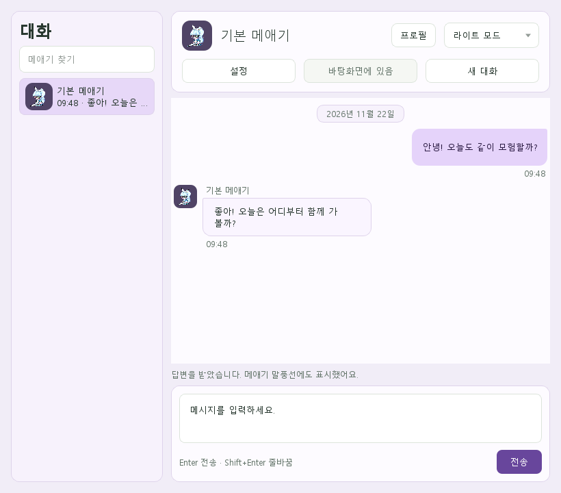
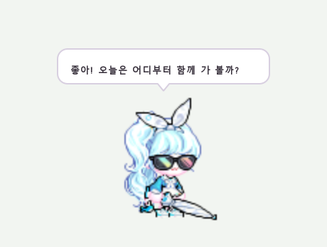
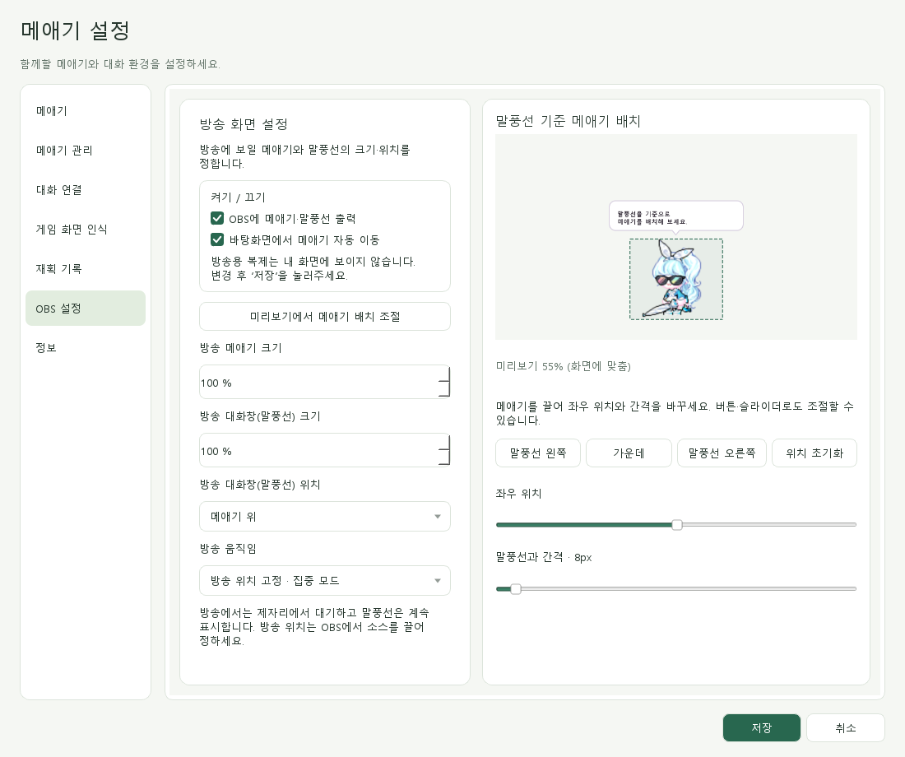
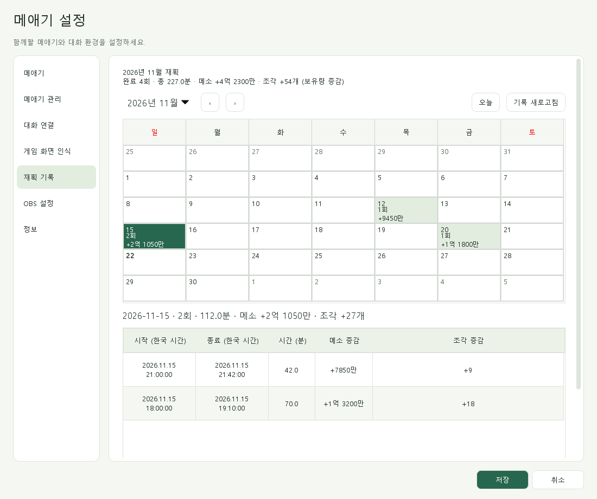
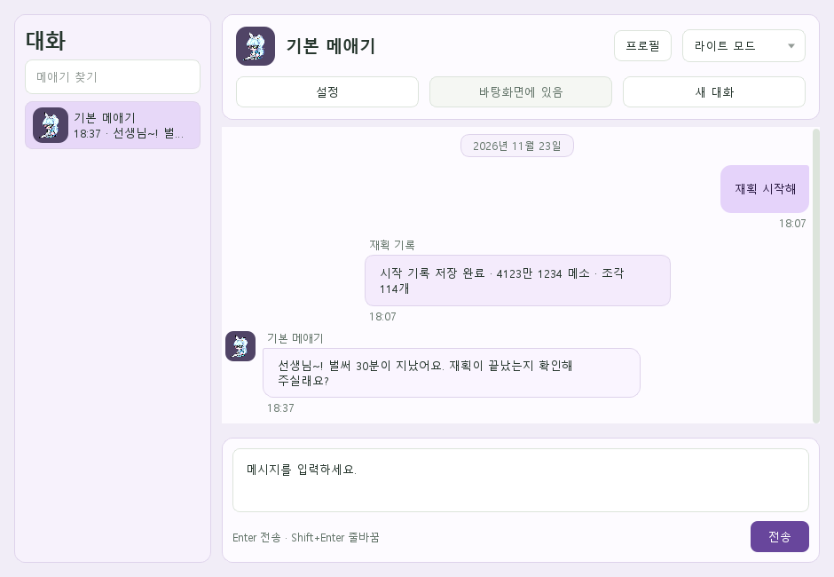
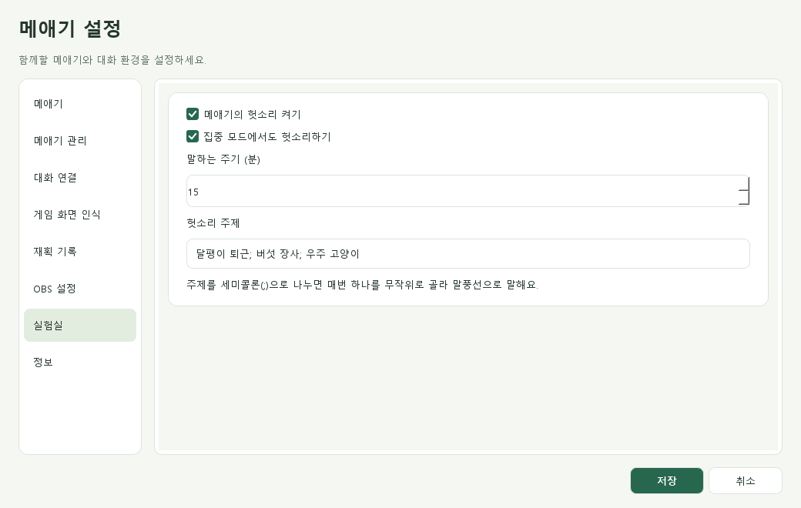
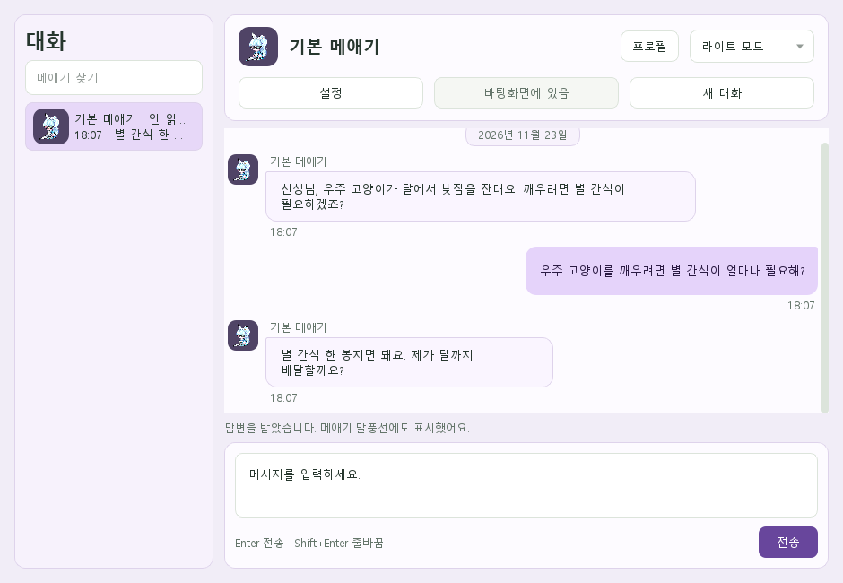

<p align="center">
  
</p>

# 메애기 비서

**내 메애기(데스크톱 시메지)와 대화하고, 재획을 기록하는 Windows 데스크톱 앱**

바탕화면을 돌아다니는 캐릭터를 등록하고 꾸밀 수 있습니다. 캐릭터의 말투와 성격을 설정해 Gemini로 대화하거나 캐릭터와 말풍선을 OBS에 표시할 수 있습니다. 메이플스토리의 보유 메소와 솔 에르다 조각을 PC에서 읽고 재획 전후의 수량을 기록합니다.

[다운로드](#다운로드와-시작하기) · [화면 예시](#화면으로-살펴보기) · [Gemini 연결](#gemini-연결과-api-키) · [소스 실행](#개발-환경과-실행) · [재획 기록](#게임-캡처ocr재획-기록) · [라이선스](#라이선스와-리소스-고지)

## 다운로드와 시작하기

1. [GitHub Releases](https://github.com/syahaeun/maeagi_biseo/releases)의 **Assets**에 `MaeagiBiseo.exe`가 있으면 다운로드해 실행합니다. EXE는 Python 설치 없이 실행할 수 있습니다. 릴리스 파일이 아직 없다면 아래의 [소스 실행 방법](#개발-환경과-실행)을 사용하세요.
2. 바탕화면에 나타난 캐릭터를 우클릭하거나 Windows 알림 영역의 트레이 아이콘을 열어 대화창, 캐릭터 관리, 설정을 엽니다.
3. AI 대화를 사용하려면 **설정 → 대화 연결**에서 Gemini API 키를 입력하고 모델을 불러옵니다. 모델을 고른 뒤 연결을 테스트하고 저장합니다. 키 발급은 [v1.0.0 릴리스의 Gemini·넥슨 API 설정 안내](docs/RELEASE-v1.0.0.md)를 참고하세요.

| 사용하려는 기능 | 준비할 것 |
| --- | --- |
| 기본 캐릭터, 이미지·GIF 등록 및 편집 | Windows. API 키 없이 사용 |
| AI 대화와 말풍선 | Gemini API 키와 프로젝트에서 사용할 수 있는 Gemini 모델 |
| 메이플스토리 캐릭터 가져오기 | NEXON Open API 키와 캐릭터 이름 |
| 메소·조각 로컬 판독 | 최소화하지 않은 메이플스토리 창. 메소에는 Windows 한국어 OCR 언어 필요 |
| 대화로 재획 시작·종료·조회 | 게임 화면 인식 설정과 도구 호출을 지원하는 Gemini 모델 |
| OBS에 캐릭터·말풍선 표시 | OBS Studio의 창 캡처 |

## 화면으로 살펴보기

아래 화면은 현재 버전의 라이트 모드에서 캡처했습니다.

### 메애기와 대화하기

대화창에서 **Enter**로 메시지를 보내고 **Shift+Enter**로 줄을 바꿉니다. 캐릭터의 답변은 바탕화면 말풍선에도 표시됩니다. 캐릭터별로 이름·성격·말투·관심사를 편집할 수 있으며 라이트·다크 테마를 지원합니다.

- 왼쪽 대화 목록에서 메애기를 이름으로 검색하고 개별 대화를 엽니다. 목록에는 최근 메시지와 읽지 않은 답변이 표시됩니다. 바탕화면에 없는 메애기는 대화창에서 불러올 수 있고, **새 대화**는 선택한 메애기의 대화를 초기화합니다.
- 대화창의 **프로필**에서 캐릭터 이미지 또는 직접 불러온 사진을 사용합니다. 이미지를 드래그하거나 확대해 원형 프레임에 맞추고, 얼굴 중심과 전체 이미지로 빠르게 전환한 뒤 크기별 미리보기로 확인할 수 있습니다.




예시 대화로 대화창과 바탕화면 말풍선에 같은 답변이 표시되는 모습을 담았습니다.

### 내 캐릭터를 바탕화면에

PNG·GIF 등의 이미지를 등록하거나 넥슨 API로 메이플스토리 캐릭터를 불러올 수 있습니다. 대기·걷기·점프 등 행동별 프레임과 표시 시간을 편집하고, 오른쪽 미리보기로 크기와 발 위치를 확인한 뒤 저장합니다. 등록한 캐릭터는 바탕화면에서 움직이며 드래그하거나 다른 창 위에 올려둘 수 있습니다.

### OBS 방송에 캐릭터와 말풍선 표시



OBS에서 캐릭터와 말풍선을 함께 표시하려면 메애기를 우클릭해 <strong>OBS 방송 창 (캐릭터 + 말풍선)</strong>을 켜고, OBS의 **창 캡처**에서 <strong>기본 메애기 · OBS 방송 (캐릭터 + 말풍선)</strong>을 선택하세요. 방송 창은 투명 화면에 캐릭터와 현재 말풍선만 그리며, 위치·애니메이션·대사 변경을 함께 반영합니다. 바탕화면과 다른 앱 화면은 포함하지 않습니다. 창 캡처 방식은 <strong>Windows 10 (1903 이상)</strong>을 사용하세요. 메시지를 입력하는 대화창 전체를 보여주려면 **기본 메애기 · 메애기와 대화**를 별도의 창 캡처로 추가하세요. 창 이름의 캐릭터 이름은 선택한 메애기에 따라 달라집니다.

**설정 → OBS 설정**에서 방송 메애기와 말풍선 크기를 각각 25~300%로 지정합니다. 움직임을 따라가거나 **방송 위치 고정 · 집중 모드**에서 대기 동작과 말풍선을 같은 자리에 표시할 수 있습니다. 방송 위치를 고정한 상태에서도 바탕화면의 자동 이동을 켤 수 있습니다. **미리보기에서 메애기 배치 조절**을 열면 드래그, 왼쪽·가운데·오른쪽 빠른 배치, 위치·간격 슬라이더로 말풍선 기준 위치를 조정합니다. OBS 장면 전체에서의 위치는 OBS에서 소스를 드래그해 정합니다. 저장한 방송 설정은 모든 메애기에 적용되고 다음 실행에도 유지됩니다.

이전 버전에서 추가한 창 캡처가 연결되지 않으면 OBS의 소스 속성에서 새 이름의 창을 다시 선택하세요.

### 재획 시간과 보유량 증감 확인



**설정 → 재획 기록**에서 월별 횟수와 합계를 보고, 날짜를 선택해 회차별 시작·종료 시각, 소요 시간, 메소·조각 증감을 확인합니다. 기록에 마우스를 올리면 시작·종료 수량이 표시됩니다. 위 화면은 예시 데이터를 넣어 현재 앱에서 캡처했습니다. 증감은 종료 시 보유량에서 시작 시 보유량을 뺀 값으로, 같은 시간에 소비·판매·창고 입출금이 있었다면 그 변화도 포함됩니다.

### 재획을 시작하고 30분 뒤에 알림 받기

시작 수량을 확인하고 **‘맞아요 · 시작’**을 누르면, 30분 뒤 메애기가 자기 말투로 재획이 끝났는지 확인해 달라고 알려줘요. 문장 생성에 실패하면 기본 안내가 나와요. 먼저 재획을 종료하거나 취소하면 예약된 알림도 취소돼요.



### 실험실에서 메애기의 헛소리 듣기

**설정 → 실험실**에서 **메애기의 헛소리 켜기**를 선택하고 말하는 주기를 분 단위로 입력해요. 주제는 `달팽이 퇴근; 버섯 장사; 우주 고양이`처럼 세미콜론(`;`)으로 구분해요. 메애기는 매번 주제 하나를 무작위로 골라 자기 말투로 한마디를 건네요. 집중 모드에서도 듣고 싶다면 **집중 모드에서도 헛소리하기**를 켜세요.



헛소리는 말풍선과 채팅에 표시돼요. 같은 채팅에서 방금 한 말을 이어서 물어볼 수 있어요. 요청이나 응답에 문제가 생기면 같은 주제로 한 번 더 시도하고, 두 번 연속 실패하면 **설정 → 대화 연결**에서 API 상태를 확인하라는 안내가 나와요. API 연결 설정이 비어 있으면 고른 주제를 넣은 기본 대사가 나와요.



## 개발 환경과 실행

Windows에서 프로젝트 루트를 기준으로 실행합니다.

```powershell
py -3.12 -m venv .venv
.\.venv\Scripts\python.exe --version
.\.venv\Scripts\python.exe -m pip install -r requirements.txt
.\.venv\Scripts\python.exe main.py
```

개발·실행·테스트·빌드·보조 스크립트는 **Python 3.12** 환경을 사용합니다. 작업 전 `.\.venv\Scripts\python.exe --version`으로 확인하며, 가상환경이 고장 나도 3.10 등 다른 버전으로 우회하지 않고 3.12 환경을 복구합니다.

모듈 진입점은 `.\.venv\Scripts\python.exe -m maeagi_biseo`입니다. Python 요구 버전과 의존성은 `pyproject.toml`, 설치 목록은 `requirements.txt`에서 관리합니다. 두 파일의 의존성 변경은 함께 반영합니다.

창·작업 표시줄·EXE에는 투명 배경의 `icon-app.ico`, 트레이에는 작은 해상도를 포함한 `icon-tray.ico`를 사용합니다. 원본 `icon.png`는 보존하며, 원본 `icon.png`의 배경만 제거하고 `.\.venv\Scripts\python.exe -m tools.export_icons`로 ICO를 생성합니다. 아이콘 변경 후 EXE를 다시 빌드합니다.

주요 의존성은 PySide6, Pillow, NumPy, OpenCV, windows-capture, Windows OCR용 WinRT 패키지, RapidOCR/ONNX Runtime입니다. 메소 판독에는 Windows 한국어 OCR 언어가 필요합니다.

## 프로젝트 구조

```text
main.py                         앱 실행 진입점
maeagi_biseo/
  app.py                        메애기 창, 마우스 입력, 우클릭·트레이 메뉴
  core/
    movement.py                 이동 상태와 물리 계산
    sprites.py                  이미지팩 탐색·검증·애니메이션 로딩
    character_store.py          사용자 캐릭터 이미지 저장
    character_catalog.py        등록 목록, 기본 캐릭터, 삭제
    character_profiles.py       캐릭터별 페르소나와 허용 행동
    capture_region.py           게임 영역 캡처와 로컬 판독
    local_ocr.py                Windows OCR·RapidOCR
    farming.py                  재획 세션과 기록 저장
    runtime_paths.py            소스·EXE의 쓰기 가능한 결과 경로
  ui/                           대화·설정·캐릭터 편집·영역 선택·기록 화면
  llm/
    client.py                   제공자별 HTTP 요청과 응답 처리
    settings.py                 제공자 설정과 키 로딩
    key_store.py                Windows DPAPI 암호화 키 저장
    tool_chat.py                대화 모델의 도구 호출 처리
  platforms/                    Windows 창 감지·배율·게임 캡처
  resources.py                  리소스 탐색과 문구 로딩
content/                        문구·페르소나·행동·테마 설정
Images/Characters/                 배포 캐릭터 이미지팩
Images/Capture/                 게임 UI 자동 탐지 기준 이미지
tests/                          단위·통합 테스트와 전용 이미지 fixture
tools/                          테스트 실행기·API 진단·캡처 CLI
docs/                           테스트·진단 문서
licenses/                       제3자 고지 원문
Test/                           생성된 로그·이미지·검증 결과 (Git 제외)
```

## 실행 흐름과 주요 동작

`main.py` → `maeagi_biseo.app.main()`에서 Qt 앱, 메애기, 대화 관리자, 대화창과 트레이를 생성합니다.

- 메애기는 프레임 없는 투명 창이며 33ms 타이머로 이동·애니메이션을 갱신합니다.
- 이동은 지상·공중·벽·천장 상태로 나뉩니다. 드래그 해제 시 관성·중력을 적용하고 화면 바닥이나 다른 창 상단에 착지합니다.
- 다른 창의 위치·표시 상태는 Windows HWND/DWM으로 조회합니다. 창 이동·크기 변경·최소화·종료와 모니터별 배율을 반영합니다.
- 대화창은 닫은 뒤 메애기 우클릭의 **대화창 열기** 또는 트레이에서 다시 엽니다.
- 캐릭터 등록·편집은 설정의 **메애기 관리** 또는 트레이에서 엽니다. 이동·일시정지·집중 모드 등은 메애기 우클릭 메뉴에서 제어합니다.
- 페르소나와 대화 이력은 캐릭터별로 관리하고 Gemini 연결 설정은 공통으로 사용합니다. 대화 이력은 실행 중에만 유지되며 프로필 사진과 자르기 설정은 저장됩니다.
- 메애기 우클릭 메뉴에서 바라보는 방향과 일시정지·집중 모드를 지정할 수 있습니다. 화면에서 찾기 어려운 메애기는 설정의 **메애기 관리** 또는 트레이 메뉴에서 바닥으로 불러옵니다.
- 네트워크·캡처·OCR은 작업 스레드 또는 별도 프로세스에서 처리합니다. GUI 스레드에서 대기시키지 않습니다.

## Gemini 연결과 API 키

현재 배포 UI의 대화 제공자는 **Gemini**입니다. **설정 → 대화 연결**에서 **사용 가능한 모델 불러오기**를 누르거나 모델 ID를 직접 입력할 수 있습니다. 연결 테스트는 저장 전 입력값으로 실제 Gemini API를 호출합니다. 모델 조회와 테스트 절차는 [Gemini API 키 발급과 연결](docs/RELEASE-v1.0.0.md#gemini-api-키-발급과-연결)을 참고하세요.

`.env.example`을 `%LOCALAPPDATA%\DesktopShimeji\.env`로 복사하고 필요한 키와 모델 항목을 채울 수 있습니다. 소스 실행과 EXE 모두 이 고정 경로를 읽으므로 EXE를 옮겨도 설정이 유지됩니다. 기존 프로젝트 루트 또는 EXE 옆의 `.env`는 AppData에 파일이 없을 때 처음 읽으면서 복사합니다. 기존 AppData 파일은 덮어쓰지 않으며 원본 파일도 삭제하지 않습니다.

키 로딩 우선순위는 다음과 같습니다.

1. 환경 변수 `GEMINI_API_KEY` 또는 `GOOGLE_API_KEY`
2. `.env`
3. AppData에 암호화해 저장한 키

환경 설정에서 Gemini 모델 ID는 `GEMINI_MODEL`로 지정할 수 있습니다. 기존 설치와의 호환을 위해 Gemini 키가 없을 때는 이전 환경 변수 `OPENAI_API_KEY`도 확인합니다.

직접 입력한 Gemini API 키는 설정을 저장할 때, 넥슨 API 키는 메이플스토리 캐릭터를 불러올 때 자동으로 저장합니다. 키는 `%LOCALAPPDATA%\DesktopShimeji\credentials\`에서 제공자별 Windows DPAPI 파일로 보관하며 같은 Windows 사용자 계정에서 사용합니다. Gemini 키 입력란을 비우고 저장하면 보관된 키를 삭제합니다.

키는 QSettings·로그·테스트 결과에 평문으로 기록하지 않습니다. `.env`와 사용자 자격 증명은 Git과 EXE 빌드에 포함하지 않습니다.

메이플 캐릭터 불러오기에서 직접 입력한 넥슨 API 키는 불러오기 버튼을 누르면 `%LOCALAPPDATA%\DesktopShimeji\credentials\nexon.dpapi`에 Windows DPAPI로 암호화해 자동 저장합니다. 창을 열면 기존 키가 입력란에 자동으로 채워지고 가려서 표시되며, 새 키를 입력하고 불러오면 교체됩니다. 환경 변수와 AppData `.env`의 `NEXON_API_KEY`는 저장된 키보다 우선합니다.

전송 시 페르소나와 대화 메시지, 필요한 도구 결과가 Gemini API로 전달됩니다. 서버 오류에 포함된 키는 표시 전에 가리며 자동 재시도는 하지 않습니다. 타임아웃은 설정에서 5~180초로 지정합니다.

## 캐릭터 이미지와 편집

기본 캐릭터는 `content/characters.json`에서 지정하며 배포 이미지팩은 `Images/Characters/`에 둡니다. 현재 기본 캐릭터는 ‘기본 메애기’, 기본 페르소나 프리셋은 ‘기본 페르소나’입니다. 로봇·토끼 이미지는 `tests/fixtures/characters/`의 테스트 전용 리소스입니다.

등록·편집창에서는 PNG·WebP·JPG·JPEG와 GIF를 추가할 수 있습니다. 행동별 미리보기에서 발 위치를 직접 클릭해 기준선을 맞출 수 있습니다. 발 위치는 창 위 착지와 화면에서 보이는 위치의 기준으로 사용합니다.

- 대기 이미지는 최소 한 장 필요하며, 없는 행동은 대기를 사용합니다.
- GIF는 PNG 프레임으로 추출하고 프레임별 표시 시간을 유지합니다. 표시 시간을 직접 바꾸면 해당 행동에 같은 시간을 적용합니다.
- 선택 프레임을 복사하면 바로 뒤에 독립된 이미지 파일을 추가하고 크기·표시 시간을 복사합니다.
- 개별 프레임 크기, 전체 배율(25~300%), 행동별 발 기준선과 비교 박스를 저장합니다. 비교 박스는 편집용 표시이며 실제 이미지에는 영향을 주지 않습니다.
- 저장한 이미지는 AppData에 복사하므로 원본 파일을 옮겨도 유지됩니다. 편집 결과는 같은 종류의 실행 중인 메애기에도 반영됩니다.
- 삭제는 확인 후 즉시 적용합니다. 사용자 이미지팩은 파일을 삭제하고 기본 제공 캐릭터는 등록 목록에서 숨깁니다. 해당 메애기도 닫으며, 마지막 등록 캐릭터는 삭제할 수 없습니다.

메이플 캐릭터 가져오기는 이름과 넥슨 API 키를 사용합니다. 대기·걷기·점프·사다리 이미지를 가져와 행동에 배정합니다.

### 도트 이미지 확대와 보정

편집창의 **저장 이미지 업스케일링**에서 사용 안 함(기본), 2배, 4배를 선택합니다. **도트 계단 줄이기**에서 Scale2x 또는 **xBRZ · 도트 보정**을 선택하고 애니메이션 미리보기의 **원본 비교**로 차이를 확인합니다. 도트 보정을 끄고 확대하면 Lanczos를 사용합니다. 저장 시 모든 행동의 프레임에 적용하며 투명도, 프레임 시간, 화면 표시 크기를 유지합니다. 반복해서 적용하면 보정 효과와 파일 크기가 누적될 수 있습니다. [xBRZ 구현·배포 안내](docs/XBRZ.md)

### 이미지팩 형식

단일 이미지는 `Images/Characters/my_character.png`처럼 추가합니다. 상태별 이미지는 캐릭터 폴더에 넣고 `character.json`으로 순서와 표시 방법을 지정합니다.

```text
Images/Characters/my_character/
  character.json
  idle.png
  walk_01.png
  walk_02.png
  climb_01.png
```

```json
{
  "name": "내 캐릭터",
  "facing": "left",
  "canvas": [130, 155],
  "foot_offset": 139,
  "animations": {
    "idle": {"frames": ["idle.png"], "frame_ms": 200},
    "walk": {"frames": ["walk_01.png", "walk_02.png"], "frame_ms": 100},
    "ceiling": {"frames": ["climb_01.png"], "frame_ms": 120}
  }
}
```

지원 상태는 `idle`, `walk`, `sleep`, `hop`, `fall`, `drag`, `climb`, `ceiling`, `talk`, `pet`입니다. 설정 파일이 없으면 상태별 파일명을 탐색하고 기본 130×155 영역을 사용합니다.

`canvas`는 표시 영역, `foot_offset`은 위쪽에서 발까지의 거리, `frame_ms`는 한 장의 표시 시간(ms)입니다. 행동별 `foot_offset`, `frame_sizes`, `frame_durations`로 개별 크기와 재생 시간을 지정할 수 있습니다. 원본 방향에 따라 이동 시 좌우 반전하고 천장에서는 회전합니다. 이미지는 비율을 유지해 아래쪽 중앙에 배치합니다.

## 게임 캡처·OCR·재획 기록

- **게임 창 캡처**는 Windows Graphics Capture로 메이플 게임 창을 대상으로 합니다. 다른 창에 가려져도 캡처하며 게임 창을 앞으로 가져오거나 메애기·대화창을 숨기지 않습니다. 최소화한 게임 창은 캡처하지 않습니다.
- **인식 영역**은 `Images/Capture/`의 기준 이미지로 탐지합니다. 자동 탐지가 맞지 않으면 설정의 **게임 화면 인식**에서 메소·조각 영역을 지정합니다. 보정 좌표는 게임 클라이언트 기준 물리 픽셀로 저장하고 창 이동을 따라갑니다. 창 크기가 바뀌면 자동 탐지로 복귀합니다.
- **OCR 판독**은 메소에 Windows OCR, 솔 에르다 조각에 RapidOCR를 사용합니다. 여러 전처리 결과가 일치할 때 값을 확정하고, 실패·불일치를 `0`으로 바꾸지 않습니다. 화면 이미지는 외부 LLM에 전송하지 않습니다.

재획 기록은 Gemini의 도구 호출을 통해 시작·종료·조회합니다. 캡처 전에는 대화창에 5초 카운트다운과 판독 상태가 표시됩니다. 시작은 메소와 조각을 모두 판독한 뒤 사용자가 수량을 확인해야 저장합니다. 종료 판독이 불확실하면 기존 진행 기록을 유지합니다. 시작·종료 기록을 저장하면 대화창에 앱이 직접 저장 결과를 표시하므로 이후 Gemini 응답에 오류가 나더라도 저장 여부를 확인할 수 있습니다.

### 재획 기록 사용 순서

1. 메이플스토리 창을 열고 보유 메소와 솔 에르다 조각 숫자가 보이도록 준비합니다.
2. **설정 → 게임 화면 인식**에서 판독이 되는지 확인합니다. 숫자를 찾지 못하면 해당 항목의 영역을 다시 지정합니다.
3. 대화창에 “**재획 시작해**”라고 입력하고 읽어 온 시작 수량을 확인합니다.
4. 같은 UI를 열고 “**재획 끝났어, 정산해 줘**”라고 입력합니다. “**어제 재획 결과 알려 줘**”처럼 날짜를 지정하거나 설정의 달력에서 기록을 볼 수 있습니다.

기록에는 실제 경과 시간과 메소·조각의 시작·종료 수량 및 증감을 저장합니다. 날짜 조회는 한국 시간의 종료일을 기준으로 하며, 수익은 보유량의 증감이므로 소비·판매의 영향도 포함합니다. 대화로 조회한 숫자와 기록은 답변을 생성하는 데 필요한 범위에서 Gemini API로 전달됩니다.

설정의 **재획 기록**은 월별 캘린더로 표시합니다. 날짜 칸에서 재획 횟수·메소 합계를 확인하고, 날짜를 선택하면 그날의 모든 완료 기록과 시간·메소·조각 합계를 볼 수 있습니다. 한국 시간의 종료일 기준으로 묶으며 월을 이동해 과거 기록도 조회합니다. 기록 개수 제한은 없습니다. 선택한 완료 기록 삭제는 즉시 적용하며 원본 캡처 파일은 유지합니다.

## 사용자 데이터와 리소스 경로

이전 버전의 캐릭터, 재획 기록, API 키와 설정은 기존 Windows 저장 위치에서 계속 읽습니다.

| 항목 | 저장 위치 |
| --- | --- |
| API 키 (Windows 암호화) | `%LOCALAPPDATA%\DesktopShimeji\credentials\` |
| 사용자 이미지팩 | `%LOCALAPPDATA%\DesktopShimeji\characters\` |
| 대화 프로필 사진 | `%LOCALAPPDATA%\DesktopShimeji\avatars\` |
| 재획 DB·캡처 | `%LOCALAPPDATA%\DesktopShimeji\Farming\` |
| EXE의 일반 OCR 결과 | `%LOCALAPPDATA%\DesktopShimeji\Capture\` |
| 개발 실행의 일반 OCR·테스트 결과 | 프로젝트의 `Test/` |
| 대화·캐릭터별 설정·영역 보정 | QSettings의 `DesktopShimeji` 아래 항목별 설정 |

Microsoft Store Python은 일부 사용자 데이터 경로를 패키지의 `LocalCache` 아래로 가상화할 수 있습니다. 소스 실행과 EXE에서 기존 기록이 다르게 보이면 실제 저장 경로를 확인합니다. 자동 이전·병합은 지원하지 않습니다.

EXE의 `content/`는 실행 파일 옆의 외부 파일을 우선하고 없으면 번들 리소스를 읽습니다. 캐릭터는 AppData의 사용자 이미지팩 → EXE 옆 `Images/Characters/` → 이전 경로인 `Images/Shimeji/` → 번들 이미지팩 순서로 탐색합니다. 같은 ID의 사용자 편집본이 기본 이미지를 대체할 수 있습니다.

## 문구와 테마 수정

| 파일 | 역할 |
| --- | --- |
| `content/texts.ko.json` | 문구·메뉴·오류 메시지 |
| `content/personas.json` | 기본 페르소나와 프롬프트 |
| `content/providers.json` | 제공자별 주소·키 변수·API 형식 |
| `content/dialogue.ko.json` | 메애기끼리의 자동 대사 |
| `content/behaviors.json` | 물리 수치·행동 확률·지속 시간 |
| `content/chat.qss` | 대화·설정·편집·파일 선택·메뉴 등 공통 스타일 |
| `maeagi_biseo/ui/chat_theme.py` | 라이트·다크 색상과 팔레트 적용 |
| `maeagi_biseo/ui/window_chrome.py` | 보조 창 테마 연결과 Windows 제목 표시줄 |
| `content/bubble.qss`, `content/bubble.json` | 말풍선 스타일과 모양 |

JSON은 UTF-8로 읽고 씁니다. 문구 키와 `{name}` 같은 치환 항목을 유지합니다. 새 창은 부모 또는 앱의 현재 테마를 따라야 하며, 흰색 배경을 직접 지정하지 않습니다. 이미지 선택은 공통 테마를 적용할 수 있는 Qt 파일 대화상자를 사용합니다.

## 테스트

```powershell
.\.venv\Scripts\python.exe -m tools.run_tests --suite unit
.\.venv\Scripts\python.exe -m tools.run_tests --suite native
.\.venv\Scripts\python.exe -m tools.run_tests --suite ui
```

`unit`은 로컬 단위 검사, `native`는 실제 Windows API 검사, `ui`는 실제 창 입력과 Gemini 연결 검사입니다. `api`·`ui`는 실제 API 사용량을 소비합니다. 실행별 결과는 `Test/runs/`에 저장하며 테스트 설정과 사용자 설정을 분리합니다.

OCR·캡처 전용 suite와 API 진단 명령, 화면 검증 기준은 [테스트 안내](docs/TESTING.md)를 참고하세요.

## EXE 빌드

```powershell
.\.venv\Scripts\python.exe -m pip install pyinstaller
.\.venv\Scripts\python.exe -m PyInstaller --clean --noconfirm MaeagiBiseo.spec
```

빌드 결과물은 `dist\MaeagiBiseo.exe`입니다. 저장소의 `MaeagiBiseo.spec`는 기본 캐릭터, 게임 화면 탐지용 이미지, 앱 아이콘, xBRZ WASM과 라이선스·대응 소스를 번들에 포함합니다. 설정 파일과 API 키는 실행 시 사용자 환경에서 읽습니다.

현재 `.gitignore`는 `build/`, `dist/`, 테스트 결과, `.env`, `CLAUDE.md`와 로컬 에이전트 설정을 제외합니다. `MaeagiBiseo.spec`, `.python-version`, `pyproject.toml`과 `requirements.txt`는 개발·빌드 환경 재현에 필요한 파일로 관리합니다.

설정창의 일부 자동 탐지 기능은 `sys.executable -m tools.<종류>_capture`로 별도 프로세스를 실행합니다. EXE에서는 Python 모듈 실행과 동일하게 동작하지 않으므로 해당 경로의 실행 파일 대응이 필요합니다.

## 참고 소스

[Shimeji-ee (Kilkakon)](https://kilkakon.com/shimeji/index.php)

## 라이선스와 리소스 고지

프로젝트 자체 코드의 라이선스는 결정 중입니다. 제3자 구성 요소에는 각각의 라이선스가 적용됩니다.

| 구성 요소 | 출처와 고지 |
| --- | --- |
| xBRZ WASM 및 대응 소스 | `@kayahr/xbrz` 1.1.2, GPL-3.0-only. [라이선스 원문](licenses/xbrz/LICENSE.md) · [대응 소스와 배포 안내](docs/XBRZ.md) |
| Shimeji / Shimeji-ee | 메애기 이동 설계 참고. [원본 고지](licenses/shimeji-originallicence.txt) · [Shimeji-ee 고지](licenses/shimeji-ee-licence.txt) |
| 메이플스토리 캐릭터와 게임 UI | 넥슨 및 해당 권리자의 리소스. 이 프로젝트는 넥슨의 비공식 팬 프로젝트이며 캐릭터 가져오기에 NEXON Open API를 사용합니다. [NEXON Open API 이용약관](https://openapi.nexon.com/ko/support/terms/) |
| 앱 아이콘과 스크린샷 | 아트워크와 캡처에 등장하는 캐릭터의 사용·재배포 조건은 해당 권리자에게 따릅니다. |


